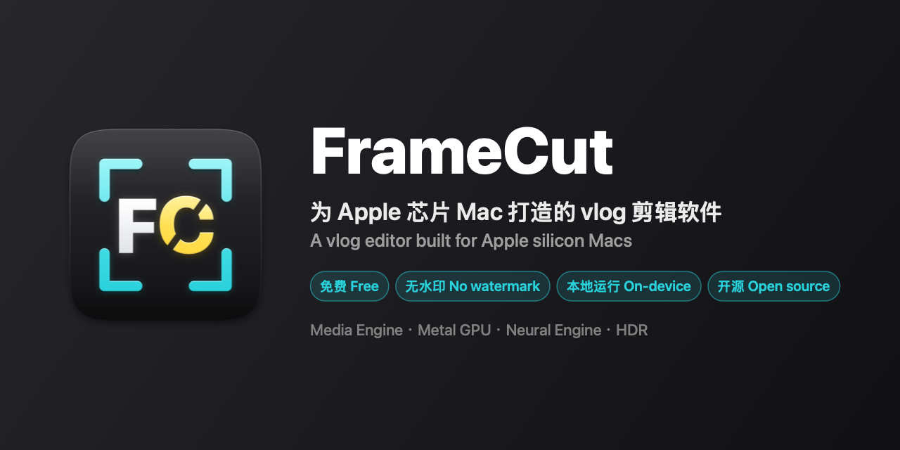

<p align="center">
  
</p>

<p align="center">
  <a href="https://github.com/lidedongsn/frame-cut/releases/latest"></a>
  <a href="https://github.com/lidedongsn/frame-cut/releases"></a>
  
  
  <a href="LICENSE"></a>
</p>

<p align="center"><b>A vlog editor built for Apple silicon Macs</b> · Free · No watermark · Fully on-device · 2.3 MB download<br>
<a href="https://github.com/lidedongsn/frame-cut/releases/latest"><b>⬇ Download the latest release</b></a></p>

<p align="center"><a href="README.md">中文</a> · English</p>

---

You shot a trip, a dinner, a weekend, and you want a three-minute vlog out of it: trim, color, add transitions,
music and captions, then export and post. FrameCut does exactly that, and does it fast.
Every feature is free, exports carry no watermark, and there is no account to sign in to.

## Why FrameCut

### Built only for Apple silicon

FrameCut runs on Apple silicon (M1 / M2 / M3 / M4) only, with no Intel compatibility baggage.
Every dedicated block on the chip is put to work, so the heavy lifting barely touches the CPU:

| Work | Runs on | What you get |
|---|---|---|
| Video decode and encode | **Media engine** (hardware codecs) | Fast exports, quiet fans, a cool laptop |
| Color, transitions, captions | **GPU** (Metal + Core Image, 16-bit float) | Sliders apply instantly; HDR highlights are never clipped |
| Speech-to-caption | **Neural Engine** + GPU | Offline, free, and no audio ever leaves your Mac |
| Media and preview | **Unified memory** | Decoded frames go straight to the GPU, with no copies back and forth |

### Fast, with numbers to show it

Measured on an **M2 Mac (16 GB)** with a roughly three-minute (170 s) vlog of 20 clips, transitions, filters,
background music and 40 captions:

| Task | Time | Speed |
|---|---|---|
| Export 1080p | about 26 s | 6.6× realtime |
| Export 1080p HDR (iPhone HLG → HLG) | about 28 s | 6.0× realtime |
| Export 4K | about 95 s | 1.8× realtime |
| Recompute the full color grade (including HSL) | under 1 ms | No lag while dragging |

Export speed is already at the limit of the M2's hardware encoder: one, two or three parallel encode sessions
deliver exactly the same total throughput. Preview resolution follows the window size and steps down
automatically if rendering falls behind, so playback stays smooth.

### Small and tidy

- **2.3 MB download, about 7 MB installed.** No embedded browser engine, no bundled plug-ins, only native system frameworks.
- The speech model (about 600 MB) is **downloaded the first time you generate captions**. If you never use
  captions it takes no space, and you can delete it from the Captions panel with one click.
- Every in-memory cache has a limit and is released when you close a project or the system runs low on memory;
  the speech model unloads itself after three idle minutes.
- Project files only reference your media. Videos are never copied, so your disk won't quietly fill up.

### Local first, private by design

Editing, color, export and speech recognition all happen on your Mac. The only time FrameCut goes online is to
download the speech model the first time (falling back to a mirror if the official host is unreachable).
Your media, projects and voice never leave the machine.

### Native HDR

Most iPhone footage is HDR (Dolby Vision / HLG). FrameCut detects it and keeps the whole pipeline in HDR:

- 10-bit decode and floating-point compositing, so highlight detail is never clipped
- True-brightness preview on EDR displays (such as the XDR display on MacBook Pro)
- Export as HDR (HLG, accepted by all major platforms), HDR10, or tone-mapped SDR
- Mix HDR clips with SDR clips, photos and captions at consistent brightness

## Features

| | |
|---|---|
| **Edit** | Split (⌘B), delete, drag to reorder, drag either end to trim, speed 0.25×–4× (pitch preserved), unlimited undo/redo; pinch to zoom the timeline |
| **Frame** | 16:9 / 9:16 / 1:1 / 4:3 / 3:4 with scale, position and rotation; new projects match the aspect ratio and frame rate of the first clip |
| **Color** | 10 looks or your own .cube LUTs; brightness, contrast, highlights, shadows, saturation, vibrance, temperature, tint; HSL for 8 color ranges; sharpen and vignette; copy/paste grades (⌥⌘C / ⌥⌘V), hold to compare with the original, save your own presets |
| **Transitions** | Dissolve, dip to black, dip to white, push in four directions, slide, wipe, zoom, blur; apply to all clips at once |
| **Audio** | Clip volume and mute; background music with position, trim, split, volume and fades |
| **Captions** | Generated on-device from speech (Whisper large-v3 turbo; Chinese, English or auto-detect; from the original audio, the audio track such as a voiceover, or both), long sentences split into lines automatically; right-click to split, merge or delete, or clear all; captions follow your video edits; import/export SRT, with burned-in captions optional on export; one shared style |
| **Export** | One-click export with settings matched to your footage; 720p / 1080p / 4K, 24–60 fps, H.264 / HEVC hardware encoding, no watermark |
| **Projects** | Autosave every 2 seconds, recent projects, relink media that has been moved |

> The interface is currently in Chinese.

## Install

1. Download `FrameCut-<version>.dmg`, open it, and drag FrameCut into **Applications**.
2. The first time you open it, macOS says it "cannot verify that FrameCut is free of malware". Click **Done**.
3. Open **System Settings → Privacy & Security**, find FrameCut under "Security", click **Open Anyway** and
   enter your password. You only need to do this once.

> FrameCut is not yet signed with a paid Apple Developer ID, which is why macOS asks you to approve it the first time.

**Requirements**: macOS 14 or later, Apple silicon (M1 / M2 / M3 / M4).

## Like it?

If FrameCut saves you time, please give it a ⭐ star so more people can find it.
Bugs and feature requests are welcome in [Issues](https://github.com/lidedongsn/frame-cut/issues).

## Development

Requires macOS 14+, Xcode 16+ and Homebrew.

```bash
make setup         # install XcodeGen and ffmpeg, generate FrameCut.xcodeproj
make run-release   # build and open the Release app (recommended for daily use)
make test          # unit tests (generates test media into TestMedia/ with ffmpeg on first run)
make check         # pre-commit check: tests + build
make dmg           # package build/FrameCut-<version>.dmg, ready to share
make help          # list all commands
```

Optional measurements (skipped by default):

```bash
make bench                                                                                       # export, per-stage and encoder benchmarks
FC_TRANSCRIBE=1 swift test --package-path Packages/FrameCutKit --filter testRealTranscription   # real speech recognition (downloads ~600 MB model)
```

Logs: open the Console app and filter by subsystem `com.lidedongsn.framecut`
(categories: project / media / export / transcribe / cache).

## Where data lives

| Location | Contents | How to remove |
|---|---|---|
| Project files `*.framecut` | Project data (references media, never copies it) | Delete the project |
| `~/Library/Application Support/FrameCut/Models` | Speech model, about 600 MB | **Delete** in the Captions panel |
| `~/Library/Application Support/FrameCut/LUTs` | Imported LUTs | Right-click in the Filters panel |
| `~/Library/Application Support/FrameCut/GradePresets.json` | Color presets | Right-click in the Filters panel |
| `~/Library/Caches/FrameCut` | A few KB of internal files | Managed automatically |

## Architecture

| Module | Responsibility |
|---|---|
| `Packages/FrameCutKit/Sources/FCCore` | Project model, timeline layout, editing operations, undo/redo, project I/O |
| `Packages/FrameCutKit/Sources/FCMedia` | Media probing, thumbnails, waveforms |
| `Packages/FrameCutKit/Sources/FCEngine` | Composition, Core Image (Metal) rendering of color, transitions and captions, export |
| `Packages/FrameCutKit/Sources/FCTranscribe` | On-device captions with WhisperKit (falls back to the hf-mirror host when needed) |
| `App` | SwiftUI interface |

## License

[MIT](LICENSE). Speech recognition is powered by [WhisperKit](https://github.com/argmaxinc/WhisperKit) (MIT) and OpenAI's Whisper models.
